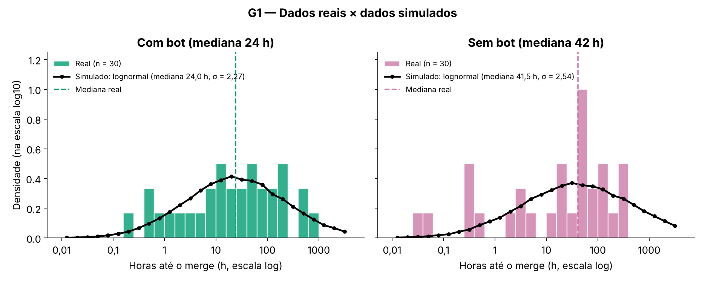
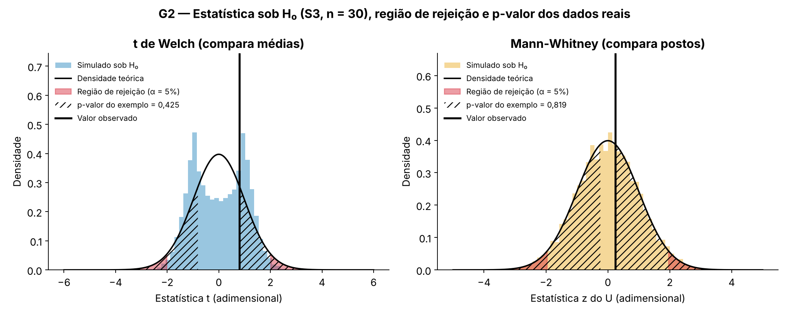
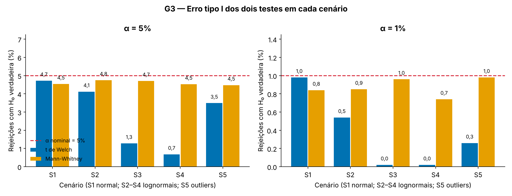
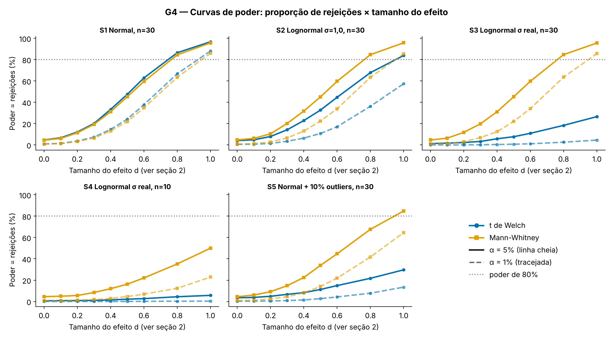

# Welch × Mann-Whitney: qual teste usar para o tempo até o merge de PRs?

Laboratório 04 · Testes de hipótese por simulação · Engenharia de Software · PUC Minas

- **Dashboard:** [https://github.com/thiagobranc0/lab04-testes-hipotese#readme](https://github.com/thiagobranc0/lab04-testes-hipotese#readme) (este README)
- **Repositório:** [https://github.com/thiagobranc0/lab04-testes-hipotese](https://github.com/thiagobranc0/lab04-testes-hipotese)
- **GitHub Projects:** [https://github.com/users/thiagobranc0/projects/1](https://github.com/users/thiagobranc0/projects/1)

> Este README é o dashboard. Ele é gerado por código, com um único comando:
> `pip install -r requirements.txt && python build.py` (semente fixa `SEED = 42`, em `src/config.py`).

## 1. Cenário

**Pergunta:** Usar um bot de revisão de código muda o tempo até o merge de um Pull Request?

**H₀:** O tempo até o merge tem a mesma distribuição em PRs com e sem bot de revisão (Welch: médias iguais; Mann-Whitney: P(com bot > sem bot) = 1/2).\
H₀: μ_com = μ_sem (Welch)  ·  P(X_com > X_sem) = 1/2 (Mann-Whitney)

**H₁:** O tempo até o merge é diferente em PRs com bot de revisão (Welch: médias diferentes; Mann-Whitney: P(com bot > sem bot) ≠ 1/2).\
H₁: μ_com ≠ μ_sem (Welch)  ·  P(X_com > X_sem) ≠ 1/2 (Mann-Whitney)

**Caudas:** Bilateral: o bot pode acelerar o merge (revisão mais rápida), mas também pode atrasá-lo (mais comentários e mais rodadas de ajuste), então testamos as duas direções.

**Dados reais:** 60 PRs mergeados do repositório público [formbricks/formbricks](https://github.com/formbricks/formbricks), que adotou o bot de revisão CodeRabbit em 19/08/2024. São 30 PRs **sem bot**, criados nos 90 dias anteriores à adoção, e 30 **com bot**, criados nos 90 dias seguintes a uma transição de 14 dias e revisados pelo CodeRabbit, sorteados com semente fixa entre 236 e 249 PRs elegíveis. Coleta feita pela API de busca do GitHub em 05/11/2026; critérios de inclusão e exclusão em `data/FONTE.md`. Lista completa de 541 candidatos, com o motivo de cada exclusão, em `data/raw/prs_candidatos.csv`.

## 2. Os dados (G1)



Os tempos reais até o merge são muito assimétricos à direita: a média fica bem acima da mediana (99 h × 24 h com bot; 71 h × 42 h sem bot) e o critério do IQR aponta 3 outliers por grupo, PRs que levaram de 11 a 27 dias até o merge. Em escala log a assimetria diminui e os outliers somem, por isso simulamos lognormais com a mediana observada e σ = IQR de ln(horas)/1,349 (2,54 sem bot; 2,27 com bot), ajuste robusto aos merges feitos em minutos, que formam a cauda esquerda do QQ-plot. A simulação usa os parâmetros do grupo sem bot nos dois grupos; como os dois testes não mudam quando todos os tempos são multiplicados pela mesma constante, é o σ, e não a mediana, que pesa no erro tipo I e no poder.

| Cenário | Distribuição | n por grupo | Finalidade |
|---|---|---|---|
| S1 | Normal(60; 20) | 30 | Pressupostos do Welch atendidos |
| S2 | Lognormal, σ = 1,0 | 30 | Assimetria moderada |
| S3 | Lognormal, σ = 2,54 (real) | 30 | Assimetria igual à dos dados reais |
| S4 | Lognormal, σ = 2,54 (real) | 10 | Assimetria e amostra pequena |
| S5 | Normal com 10% de outliers | 30 | Caudas pesadas |

**Tamanho do efeito d** (eixo do G4): nos cenários normais (S1, S5), um grupo é deslocado em d desvios-padrão; nos
lognormais (S2–S4), ln(horas) é deslocado em d·σ, ou seja, a mediana é multiplicada por e^(d·σ). No S3, d = 0,2
multiplica a mediana por 1,7 e d = 1, por 12,7.

## 3. Como os testes funcionam (G2)



O t de Welch compara as médias dos grupos, e o Mann-Whitney compara postos, isto é, se um grupo tende a ter valores maiores que o outro. O gráfico mostra a distribuição de cada estatística quando H₀ é verdadeira (20.000 experimentos simulados no cenário S3), e as caudas em vermelho formam a região de rejeição, bicaudal porque o bot poderia acelerar ou atrasar o merge. Nos dados reais, a área hachurada dá p = 0,42 (Welch) e p = 0,82 (Mann-Whitney): sem efeito, diferenças assim ou maiores apareceriam em 42% e 82% dos experimentos, o que não é a probabilidade de H₀ ser verdadeira. Com dados tão assimétricos, só 1,6% das estatísticas t simuladas caem na região de rejeição, em vez de 5%.

**Exemplo com um conjunto simulado.** Geramos 30 PRs por grupo com a mediana do grupo com bot 30% menor
(`simulacao.gerar_dados`, equivalente a d ≈ 0,14 no G4) e aplicamos os dois testes (`testes.aplicar_testes`):

| Teste | Estatística | p-valor | Tamanho do efeito | Decisão (α = 5%) |
|---|---|---|---|---|
| t de Welch | t = 0,85 | 0,402 | g de Hedges = 0,22 | Não rejeita H₀ |
| Mann-Whitney | U = 425 | 0,717 | delta de Cliff = -0,06 | Não rejeita H₀ |

Nenhum dos testes rejeitou H₀, embora neste conjunto o efeito exista: é um erro tipo II. Com σ ≈ 2,5 e 30 PRs por grupo, um efeito desse tamanho costuma passar despercebido, e o G4 mostra com que frequência cada teste o detecta.

## 4. Erro tipo I (G3)



O Mann-Whitney ficou entre 4,5% e 4,8% em todos os cenários, sempre um pouco abaixo de 5% (provavelmente pela aproximação normal com correção de continuidade), sem nunca ficar liberal; o erro de simulação é de ±0,4 p.p. O t de Welch ficou perto de 5% só com dados normais (4,7%) e se afastou para baixo nos demais: 4,1% (S2), 3,5% (S5), 1,3% (S3) e 0,7% (S4, n = 10). Ele ficou conservador: a estatística t é dominada por poucos valores extremos e raramente cruza o valor crítico, então erra pouco, mas ao custo de poder. O painel da direita mostra o mesmo com α = 1%.

## 5. Poder (G4)



Com dados normais (S1) os testes têm poder quase igual, com leve vantagem do Welch (até 3,3 p.p.). Em todas as outras situações o Mann-Whitney detecta melhor, e a diferença cresce com o efeito: com d = 1, ele chega a 96% contra 27% do Welch no cenário real (S3), e a 50% contra 6% com n = 10. A vantagem muda de lado apenas quando os dados são normais. Com α = 1% (linhas tracejadas), todas as curvas descem, mas a ordem se mantém (S3, d = 1: 86% contra 5%).

## 6. Dados reais

| Teste | Compara | Estatística | p-valor | Tamanho do efeito | Conclusão (α = 5%) |
|---|---|---|---|---|---|
| t de Welch | médias | t = 0,81 (gl = 46,9) | 0,425 | diferença de médias = 28,3 h; g de Hedges = 0,21 | Não rejeita H₀ |
| Mann-Whitney | postos | U = 466 (z = 0,24) | 0,819 | delta de Cliff = 0,04; razão de medianas = 0,58 (IC 95% bootstrap: 0,23 a 3,93) | Não rejeita H₀ |

Os dois testes chegam à mesma conclusão: não há evidência de que o bot mude o tempo até o merge (p = 0,425 e 0,819). O efeito não tem importância prática clara: a média é maior com bot (99,4 h contra 71,0 h), mas a mediana é menor (24,0 h contra 41,5 h), e a chance de um PR com bot ser mais lento que um sem bot é de cerca de 52%. O intervalo da razão de medianas (0,23 a 3,93) inclui efeitos grandes nos dois sentidos, ou seja, com 30 PRs por grupo o estudo tem pouco poder para decidir. Como os grupos vêm de períodos diferentes (antes e depois do bot), mesmo uma diferença não seria atribuível só ao bot.

## 7. Conclusão

**O que esperávamos antes de simular** (registrado em `src/cenario.py`): Esperamos que o Mann-Whitney se saia melhor. O tempo até o merge é muito assimétrico, com cauda longa e outliers (PRs que ficam dias abertos). Esses valores extremos inflam a variância e puxam a média, o que reduz o poder do t de Welch. O Mann-Whitney usa postos e é pouco afetado por outliers.

**O que encontramos:** o padrão se confirmou, com uma diferença maior que a esperada. Com a assimetria dos dados reais, o
Welch quase não detecta efeitos (27% de poder com d = 1) e fica conservador
(1,3% de erro tipo I), porque a média de uma lognormal com σ ≈ 2,5 é dominada por poucos PRs
extremos. Com dados normais, os dois testes ficaram equivalentes.

**Recomendação:** usar o Mann-Whitney para comparar tempos de merge. Ele manteve o erro tipo I perto de 5% em todos os
cenários e perdeu no máximo 3,3 p.p. de poder com dados normais. **Mudaríamos para o Welch** se os dados fossem
aproximadamente normais (por exemplo, tempos de build medidos várias vezes) ou se a pergunta fosse sobre a média, como o
total de horas gasto. **Principal limitação:** os grupos são de períodos diferentes (antes e depois do bot), de um único
repositório e com n = 30, e os dados simulados são uma aproximação (lognormal, mesma forma e mesmo σ nos dois grupos).

---

## Como reproduzir

```bash
pip install -r requirements.txt
python build.py              # gera images/ e este README (usa data/processed/ se já existir)
python build.py --resimular  # refaz também a simulação Monte Carlo
python -m src.coleta         # (opcional) refaz a coleta dos PRs reais
python -m src.analise        # (opcional) estatísticas descritivas e ajuste da lognormal
streamlit run app.py         # (opcional) versão interativa complementar
```

## Estrutura do repositório

| Arquivo | Conteúdo |
|---|---|
| `build.py` | comando único: simulação (se preciso) + gráficos + README |
| `src/config.py` | semente, α, nº de simulações, cores por teste, links |
| `src/cenario.py` | pergunta, H₀/H₁, caudas, expectativa prévia, parâmetros e textos |
| `src/coleta.py` | coleta dos PRs reais via API de busca do GitHub (`data/FONTE.md`) |
| `src/analise.py` | estatísticas descritivas e ajuste da lognormal (`cenario.PARAMS`) |
| `src/simulacao.py` | gerador de dados simulados do cenário |
| `src/testes.py` | t de Welch, Mann-Whitney e tamanhos de efeito |
| `src/simulate.py` | simulação Monte Carlo de Q1–Q3 → `data/processed/` |
| `src/readme.py` | gera `images/` (G1–G4) e este README |
| `src/graficos.py`, `app.py` | versão interativa em Streamlit (complementar) |

## Equipe

| Integrante | Papel |
|---|---|
| Thiago Branco ([@thiagobranc0](https://github.com/thiagobranc0)) | C — dashboard e setup |
| Pedro Luiz Nato ([@pedrrr](https://github.com/pedrrr)) | A — dados reais |
| Bruna Costa ([@Brunamark](https://github.com/Brunamark)) | B — cenário, simulação e testes |

Toda mudança nasce de uma Issue, é feita em uma branch `feat/<nº-issue>-<slug>`, tem commits que referenciam a Issue e
entra na `main` por Pull Request com `Closes #N`.
